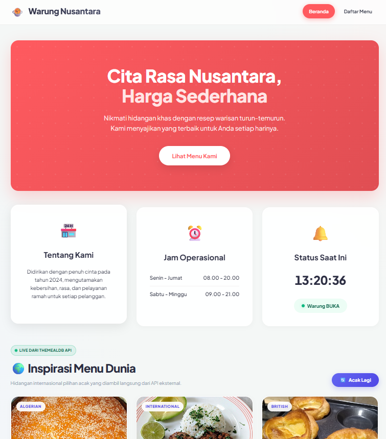
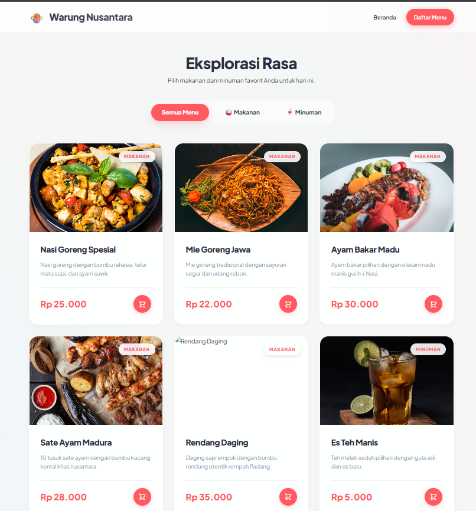
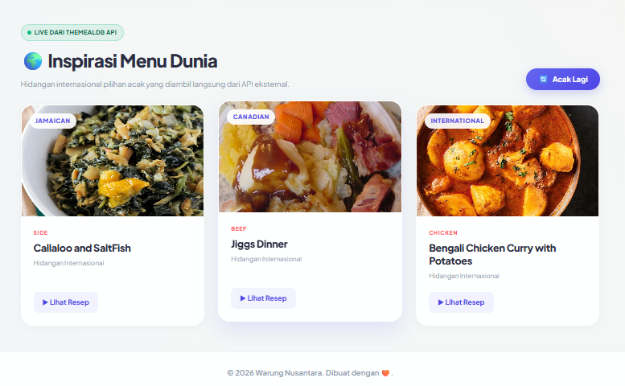

# 🍲 Warung Nusantara

> Website profil warung makan berbasis HTML, CSS, dan JavaScript dengan integrasi **External API** (TheMealDB).

---

## 📸 Screenshot

### 🏠 Halaman Beranda



---

### 🍽️ Halaman Daftar Menu



---

### 🌍 Fitur API Eksternal (TheMealDB)



---

## 📌 Deskripsi Proyek

**Warung Nusantara** adalah website profil restoran sederhana yang dibuat sebagai tugas mata kuliah **Pemrograman Web**. Website ini menampilkan informasi warung, daftar menu makanan & minuman, serta mengintegrasikan **API Eksternal** untuk menampilkan inspirasi hidangan dari seluruh dunia secara *real-time*.

---

## ✨ Fitur Utama

### 🏠 Halaman Beranda (`index.html`)
- **Hero Section** — Tagline dan tombol CTA menuju halaman menu
- **Jam Operasional** — Informasi jam buka warung
- **Status Real-Time** — Jam digital live + indikator BUKA/TUTUP otomatis berdasarkan waktu lokal
- **🌍 Inspirasi Menu Dunia** *(External API)* — Menampilkan 3 hidangan acak dari seluruh dunia dengan tombol **Acak Lagi**

### 🍽️ Halaman Daftar Menu (`menu.html`)
- **Menu Lokal** — Daftar makanan & minuman Warung Nusantara dari file JSON
- **Filter Kategori** — Tombol filter: Semua, Makanan, Minuman
- **🌍 Menu Internasional** *(External API)* — Jelajahi hidangan dari 6 kategori: Chicken, Seafood, Beef, Pasta, Dessert, Vegetarian

---

## 🔌 Integrasi API Eksternal

Website ini menggunakan **[TheMealDB API](https://www.themealdb.com/api.php)** — API gratis tanpa autentikasi.

### Endpoint yang Digunakan

| Method | Endpoint | Kegunaan | Halaman |
|--------|----------|----------|---------|
| `GET` | `/api/json/v1/1/random.php` | Ambil 1 hidangan acak | `index.html` |
| `GET` | `/api/json/v1/1/filter.php?c={kategori}` | Daftar menu per kategori | `menu.html` |
| `GET` | `/api/json/v1/1/lookup.php?i={id}` | Detail lengkap hidangan | `menu.html` |

### Contoh Response API

```json
// GET https://www.themealdb.com/api/json/v1/1/random.php
{
  "meals": [
    {
      "idMeal": "52772",
      "strMeal": "Teriyaki Chicken Casserole",
      "strCategory": "Chicken",
      "strArea": "Japanese",
      "strMealThumb": "https://www.themealdb.com/images/media/meals/...",
      "strYoutube": "https://www.youtube.com/watch?v=4aZr5hZXP_s",
      "strTags": "Meat,Casserole"
    }
  ]
}
```

### Implementasi `fetch()` di JavaScript

```javascript
// Halaman index — 3 random meals secara paralel
const BASE = 'https://www.themealdb.com/api/json/v1/1';

async function fetchRekomendasi() {
    const responses = await Promise.all([
        fetch(`${BASE}/random.php`),
        fetch(`${BASE}/random.php`),
        fetch(`${BASE}/random.php`)
    ]);
    const data  = await Promise.all(responses.map(r => r.json()));
    const meals = data.map(d => d.meals[0]);
    // ... render ke DOM
}

// Halaman menu — filter kategori + detail
async function fetchMenuAPI(category) {
    const res   = await fetch(`${BASE}/filter.php?c=${category}`);
    const list  = (await res.json()).meals.slice(0, 8);

    const details = await Promise.all(
        list.map(m => fetch(`${BASE}/lookup.php?i=${m.idMeal}`))
    );
    const meals = await Promise.all(details.map(r => r.json()));
    // ... render ke DOM
}
```

---

## 🗂️ Struktur Proyek

```
tugas 1/
├── index.html          # Halaman Beranda
├── menu.html           # Halaman Daftar Menu
├── script.js           # Logika JavaScript + API Calls
├── styles.css          # Styling lengkap (termasuk API UI)
├── data/
│   ├── menu.json       # Data menu lokal (8 item)
│   └── info.json       # Informasi warung
└── README.md           # Dokumentasi ini
```

---

## 🛠️ Teknologi

| Teknologi | Keterangan |
|-----------|------------|
| HTML5 | Struktur halaman semantik |
| CSS3 | Styling + Glassmorphism + Animasi |
| JavaScript ES6+ | `fetch()`, `async/await`, `Promise.all()` |
| Fetch API | Web API bawaan browser untuk HTTP request |
| Intl API | Format harga ke Rupiah (`Intl.NumberFormat`) |
| TheMealDB API | External REST API — data hidangan global |
| Google Fonts | Tipografi: *Plus Jakarta Sans* & *Outfit* |
| XAMPP | Local server untuk development |

---

## 🚀 Cara Menjalankan

### Prasyarat
- [XAMPP](https://www.apachefriends.org/) sudah terinstall dan **Apache aktif**
- Koneksi internet (untuk External API)

### Langkah

1. **Clone / letakkan project** di folder XAMPP:
   ```
   e:\Xampp\htdocs\Pemweb\tugas 1\
   ```

2. **Jalankan Apache** di XAMPP Control Panel

3. **Buka browser**, akses:
   ```
   http://localhost/Pemweb/tugas%201/index.html
   ```

> ⚠️ **Penting:** Jangan buka file HTML langsung (dobel klik). Harus melalui XAMPP (`http://localhost/...`) agar `fetch()` ke API eksternal dapat berjalan dengan benar.

---

## 📡 Cara Kerja API — Alur Data

```
Browser (User)
     │
     ├─── fetch("data/menu.json")          ──► File Lokal JSON
     │         └── renderMenu()                   (menu lokal)
     │
     ├─── fetch("themealdb.com/random.php") ──► TheMealDB API
     │         └── fetchRekomendasi()              (index page)
     │
     └─── fetch("themealdb.com/filter.php") ──► TheMealDB API
               └── fetchMenuAPI(kategori)          (menu page)
                        │
                        └─── fetch("themealdb.com/lookup.php") ──► Detail tiap item
```

---

## 🎨 Desain UI

- **Color Palette:**
  - Primary: `#FF5A5F` (merah coral)
  - API Accent: `#6366f1` (indigo)
  - Secondary: `#2B2D42` (navy)
- **Style:** Glassmorphism + Card-based layout
- **Efek:** Hover animation, skeleton loading, pulse indicator, shimmer effect
- **Responsive:** Mobile-friendly grid layout

---

## 📝 Catatan Pengembangan

| Tanggal | Perubahan |
|---------|-----------|
| 2026-10 | Setup awal project, HTML & CSS dasar |
| 2026-11-19 | Integrasi TheMealDB External API, fitur rekomendasi & menu internasional |

---

## 👨‍💻 Pembuat

> **Tugas 1 — Pemrograman Web**  
> Warung Nusantara Website  
> © 2026

